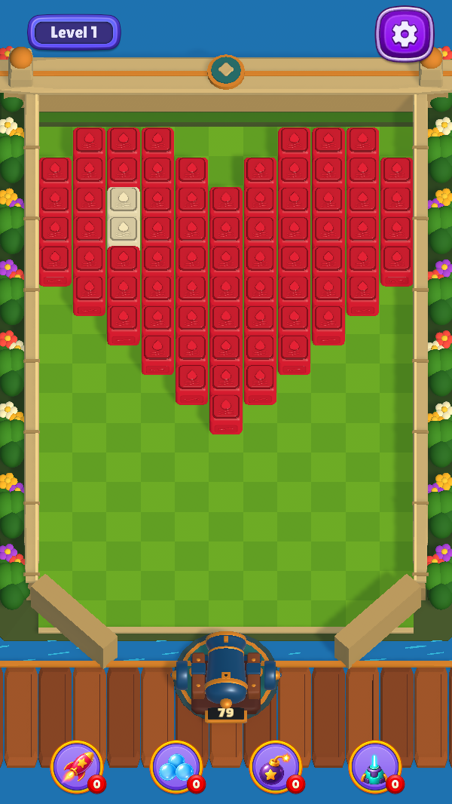
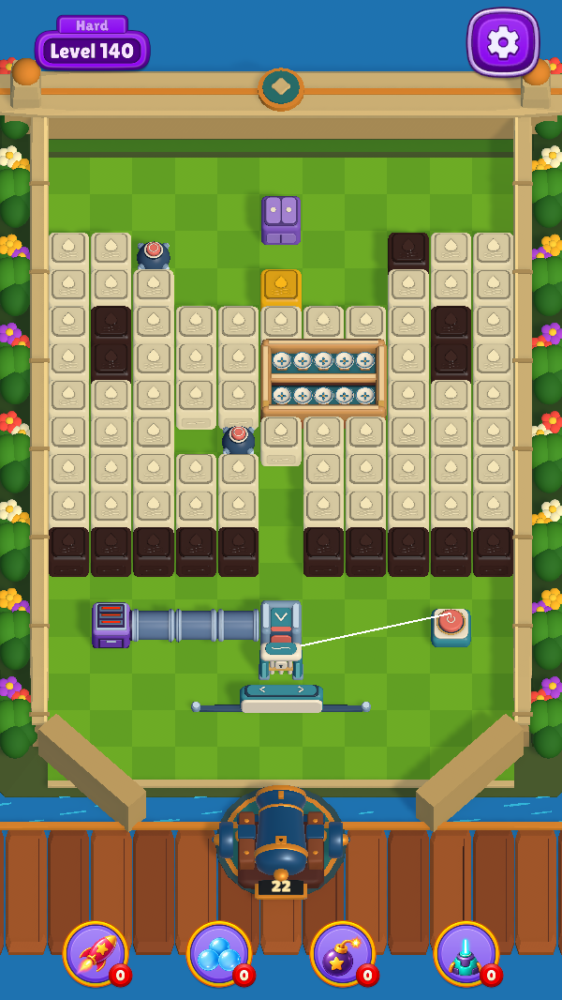

# Bounce 고정 플레이 영역

2026-10-27 · `develop-bounce`

레벨마다 카메라가 멀어져 기물이 작아지는 문제를 해결하기 위해 외곽 Wall과 셀 크기를 고정했다. 140개 출시 레벨은 동일한 공간에서 내부 배치만 바꾼다.

| 항목 | 적용 기준 |
| --- | --- |
| 카메라 | 기준 Orthographic Size 11.75, 기울기 60° |
| 외곽 | 11열 × 16행 규모, 모든 출시 레벨의 실제 충돌 Wall·범퍼 위치 동일 |
| 셀 | 1유닛 고정. Grid가 달라져도 블록·기믹을 자동 축소하지 않음 |
| 내부 Grid | 최대 11×16, 가로 중앙·세로 상단 정렬 |
| 화면 비율 | 9:16·태블릿은 11.75, 더 좁은 화면은 좌우 잘림 방지에 필요한 만큼 Size 증가. 같은 기기에서는 레벨 간 동일 |
| HUD | 레벨 표시와 설정은 상단, 부스터 네 개는 하단 한 줄 |

Wall만 고정하고 내부 Grid를 늘려 채우는 방식은 셀 크기가 달라진다. 레벨마다 카메라를 맞추는 방식 역시 기물 크기와 조준 감각이 바뀐다. 이번에는 **고정 외곽 + 고정 셀 + 가변 배치**를 선택해 반사 경계와 기물 크기를 예측할 수 있도록 했다.

35가지 사물 도안을 고정 공간에 맞게 다시 구성했다. 블록은 레벨당 41~97개이며, 큰 도안을 그대로 축소해 넣는 대신 배치를 조정했다. 140레벨 및 신규 기믹 도입 순서(14·21·41·61·81·101·121)는 유지한다. 변경된 반사 경로를 실제 게임 물리로 다시 측정하고 역할별 여유를 더해 탄 수를 보정했다.

정원형 잔디 격자, 크림색 석재, 꽃과 관목, 물길과 목재 부두를 적용했다. 대포는 기존 포신·차륜 형태를 유지하면서 청색 금속과 황동 재질을 다듬었다. 장식에는 게임 충돌을 추가하지 않았다.

## 실제 게임 화면

| 레벨 1 | 레벨 140 |
| --- | --- |
|  |  |

[긴 휴대폰 화면](stage-013-600x1333.png) · [태블릿 화면](stage-013-768x1024.png) · [레벨 카탈로그](../bounce-level-catalog/index.html)

## 편집과 검증

- `BounceBoardLayout`이 출시 외곽과 기준 카메라 크기를 관리한다. 외곽 변경은 전체 물리·해법 재검증 대상이다.
- `BK Kit > Level Editor`에서 내부 Grid와 배치를 편집한다. 고정 외곽을 넘는 데이터는 저장·실행을 거부한다.
- 생성 원본은 `tools/balance/build_release_levels.py`. 수동 JSON 수정은 재생성 시 덮어쓰므로 영구 변경은 원본에도 반영한다.
- `BouncePortraitPresentationTests`: 9:16·9:20·3:4에서 Wall 위치·크기, 카메라 Size, 기물 좌표, HUD 및 스크린샷 확인.
- `BounceReleaseFlowTests`: 140개 전체의 지급 탄 이내 클리어와 동일 입력 재현, L14의 일반 속도 물리 재현, 캠페인 종료 시 하트 보존 확인.
- [최종 PlayMode 결과](../bounce-level-catalog/evidence/release-test-results.xml) · [EditMode 결과](../bounce-level-catalog/evidence/release-edit-results.xml)

자동 해법 존재를 사람의 성공률로 환산하지 않는다. 화면 캡처와 검증은 Unity Editor에서 수행했으며 실기기 플레이 평가는 별도다.
